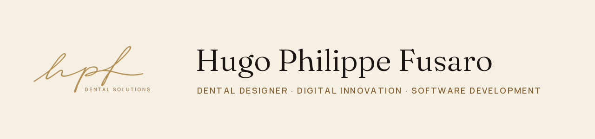
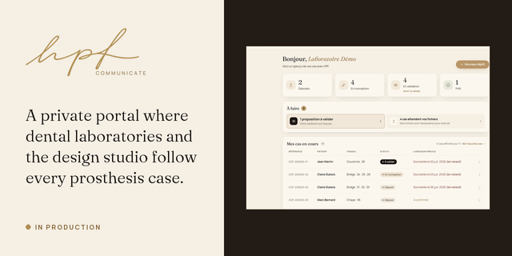
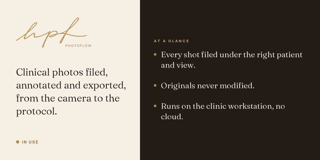
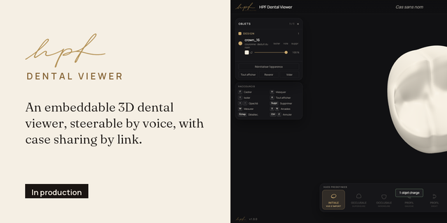
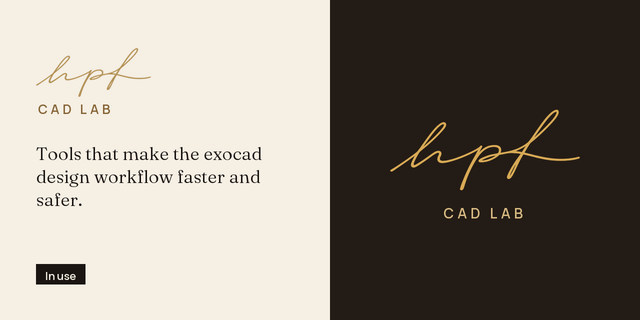
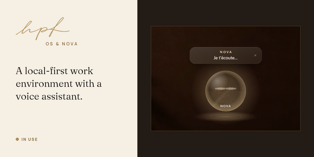
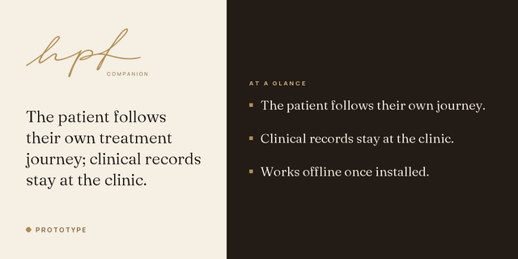
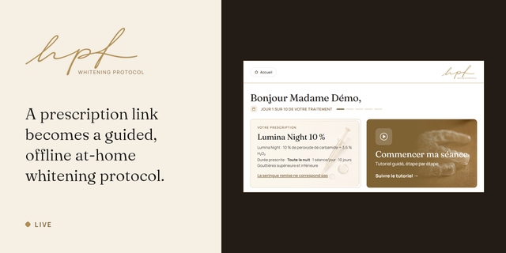
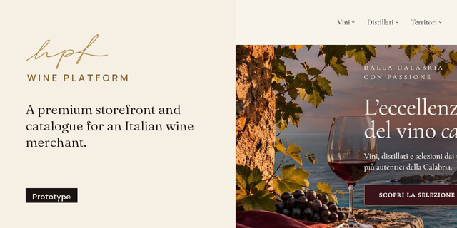

Trained as a dental technician from 2013, I have designed dental restorations in exocad since 2016 and trained more than 30 laboratory teams in CAD/CAM across Europe.  
As a final-year dental student, graduating in 2027, I now see the same workflow from the chair.  
The tools below come from both sides: real problems of the laboratory, the clinic and the patient, turned into software I design and build myself.

## Selected projects

<table>
<tr><td width="50%" valign="top"> <b><a href="https://github.com/hpfdentalsolutions/hpf-communicate">HPF Communicate</a></b> Clinical communication platform · <i>In production</i> Clinical & Patient Experience</td><td width="50%" valign="top"> <b><a href="https://github.com/hpfdentalsolutions/hpf-photoflow">HPF PhotoFlow</a></b> Dental photography workflow · <i>In use</i> Clinical & Patient Experience</td></tr>
<tr><td width="50%" valign="top"> <b><a href="https://github.com/hpfdentalsolutions/hpf-dental-viewer">HPF Dental Viewer</a></b> 3D dental visualization · <i>In production</i> Digital Dentistry & CAD/CAM</td><td width="50%" valign="top"> <b><a href="https://github.com/hpfdentalsolutions/hpf-cad-lab">HPF CAD Lab</a></b> Digital dental design tools · <i>In use</i> Digital Dentistry & CAD/CAM</td></tr>
<tr><td width="50%" valign="top"> <b><a href="https://github.com/hpfdentalsolutions/hpf-os">HPF OS & NOVA</a></b> AI-powered software ecosystem · <i>In use</i> Software & Artificial Intelligence</td><td width="50%" valign="top"> <b><a href="https://github.com/hpfdentalsolutions/hpf-companion">HPF Companion</a></b> Digital patient experience · <i>Prototype</i> Clinical & Patient Experience</td></tr>
<tr><td width="50%" valign="top"> <b><a href="https://github.com/hpfdentalsolutions/hpf-whitening">HPF Whitening Protocol</a></b> At-home whitening, guided step by step · <i>Live</i> Clinical & Patient Experience</td><td width="50%" valign="top"> <b><a href="https://github.com/hpfdentalsolutions/vini-deccellenza-platform">Vini d'Eccellenza Platform</a></b> Premium wine storefront and catalogue · <i>Prototype</i> Software & Artificial Intelligence</td></tr>
</table>

Each repository documents one project: the problem, the solution, my role, the technologies, the real status and screenshots on demonstration data.  
The source code is proprietary and stays private.

## Skills

- **Dental:** CAD design in exocad DentalCAD, CAD/CAM workflows, training of laboratory teams, clinical photography
- **Software:** Python, TypeScript, FastAPI, Next.js, Three.js, Electron
- **Data and infrastructure:** PostgreSQL (Supabase), SQLite, Docker, Cloudflare, Netlify
- **3D and AI:** Blender scripting, computational geometry with NumPy, local speech recognition and synthesis, LLM integration

## Contact

[hpfdentalsolutions.com](https://hpfdentalsolutions.com) · [LinkedIn](https://www.linkedin.com/in/hugo-philippe-fusaro) · [HPF Dental Solutions on GitHub](https://github.com/hpfdentalsolutions)
